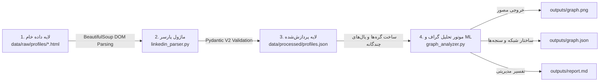

# پروژه تحلیل شبکه سازمانی و خوشه‌بندی هوشمند تیم Hugging Face

این پروژه یک خط لوله جامع، خودکار و مبتنی بر داده‌های موثق برای گردآوری و تجزیه اسنپ‌شات‌های پروفایل لینکدین، اعتبارسنجی دقیق داده‌ها با Pydantic V2، تشکیل گراف ارتباطی چندوجهی (Organizational Graph)، محاسبه شاخص‌های مرکزیت شبکه و خوشه‌بندی هوشمند نقش‌ها و مهارت‌ها است.

---

## ۱. راهنمای گام‌به‌گام نصب و اجرا

برای اجرای پروژه در محیط تمیز (Clean Environment)، مراحل زیر را به ترتیب اجرا نمایید:

### گام ۱: دریافت پروژه و ورود به پوشه کاری
```bash
cd "پروژه سایبریان"
```

### گام ۲: ایجاد محیط مجازی پایتون (پیشنهادی)
```bash
python -m venv .venv
# فعال‌سازی در ویندوز (PowerShell):
.\.venv\Scripts\Activate.ps1
# فعال‌سازی در لینوکس/مک:
# source .venv/bin/activate
```

### گام ۳: نصب وابستگی‌ها
تمامی کتابخانه‌های موردنیاز (شامل `pydantic`، `beautifulsoup4`، `networkx`، `scikit-learn`، `matplotlib`، `pandas`، `numpy` و `pytest`) در فایل `requirements.txt` ثبت شده‌اند:
```bash
pip install -r requirements.txt
```

### گام ۴: اجرای کل پایپلاین با یک دستور واحد
با اجرای دستور زیر، داده‌های خام HTML خوانده می‌شوند، اعتبارسنجی و ذخیره در لایه پردازش‌شده انجام می‌گیرد، گراف سازمانی تشکیل می‌شود، مدل خوشه‌بندی اجرا می‌گردد و تمام خروجی‌های متنی و تصویری در پوشه `outputs/` ساخته می‌شوند:
```bash
python main.py
```

### گام ۵: اجرای تست‌های خودکار (QA & Unit Tests)
برای اطمینان از صحت عملکرد پارسر، ساخت گراف، محاسبات مرکزیت، ساختار خروجی‌ها و وابستگی‌ها:
```bash
python -m pytest tests/
```

---

## ۲. ساختار ریپازیتوری (Repository Structure)

```plaintext
├── data/
│   ├── raw/
│   │   └── profiles/                # اسنپ‌شات‌های خام HTML لینکدین (hf_001.html تا hf_010.html)
│   └── processed/
│       ├── hf_001.json ... hf_010.json  # پرونده‌های فردی اعتبارسنجی‌شده (Pydantic Schema)
│       ├── profiles.json            # دیتاست تجمیعی ۱۰ عضو منتخب تیم Hugging Face
│       └── relationships.json       # ماتریس روابط مستند، وزن یال‌ها و لینک شواهد
├── outputs/
│   ├── graph.png                    # تصویر مصورسازی گراف (رنگ‌بندی دپارتمان، اندازه = Betweenness Centrality)
│   ├── graph.json                   # ساختار استاندارد گره‌ها، یال‌ها، امتیاز مرکزیت و شماره خوشه‌ها
│   ├── graph_analysis.json          # خروجی تکمیلی تحلیل شاخص‌ها و جوامع ماژولار
│   └── report.md                    # گزارش تحلیلی اجرایی شامل تفسیر نتایج و معرفی گره‌های کلیدی
├── src/
│   ├── analytics/
│   │   └── graph_analyzer.py        # موتور تحلیل گراف (NetworkX)، شباهت مهارت و خوشه‌بندی (scikit-learn)
│   ├── collectors/
│   │   └── linkedin_collector.py    # لایه گردآوری و مدیریت فایل‌های خام و پردازش‌شده
│   ├── processors/
│   │   └── linkedin_parser.py       # پارسر چندحالته ساختار DOM لینکدین (Topcard، سوابق، مهارت‌ها)
│   └── validators/
│       └── schemas.py               # مدل‌های اعتبارسنجی Pydantic V2 و وضعیت دسترسی فیلدها
├── tests/
│   ├── test_parser.py               # تست‌های استخراج و تایید اصالت داده‌های پارسر
│   ├── test_graph_analyzer.py       # تست‌های ساخت گراف، مرکزیت، خوشه‌بندی و فرمت خروجی‌ها
│   └── test_requirements.py         # تست تضمین ثبت تمام وابستگی‌های ضروری
├── main.py                          # نقطه ورود واحد و ارکستراتور کل پایپلاین
├── requirements.txt                 # لیست کامل کتابخانه‌ها و نسخه‌های موردنیاز
├── README.md                        # مستندات راهنمای اجرا، معماری و جریان داده
└── notes.md                         # پاسخ‌های مهندسی و معماری به سوالات مقیاس‌پذیری
```

---

## ۳. جریان داده در پایپلاین (Data Flow Architecture)



1. **ورود داده خام (Raw Ingestion):** فایل‌های HTML احراز هویت شده در `data/raw/profiles/` توسط `LinkedInCollector` خوانده می‌شوند (بدون هیچ داده تخمینی یا ساختگی).
2. **تجزیه و اعتبارسنجی (Parsing & Validation):** ماژول `LinkedInParser` اطلاعات سرتیتر، عنوان شغلی، سوابق کاری، سوابق تحصیلی و مهارت‌ها را استخراج کرده و با مدل‌های `LinkedInProfileRecord` در `src/validators/schemas.py` اعتبارسنجی می‌کند.
3. **تشکیل گراف ارتباطی (Graph Construction):** ماژول `GraphAnalyzer` ۱۰ گره را با ویژگی‌های عنوان شغلی و دپارتمان تعریف کرده و ۳ لایه یال ایجاد می‌کند: تعاملات مستقیم مستند، اشتراک سازمانی/پروژه‌ای، و یال‌های وزن‌دار مبتنی بر ترکیب شباهت معنایی (TF-IDF Cosine) و ژاکارد (Jaccard) روی مهارت‌ها.
4. **تحلیل مرکزیت و خوشه‌بندی (Analytics & ML):** محاسبه شاخص‌های Degree، Betweenness و Closeness برای یافتن پل‌های ارتباطی سازمان و دسته‌بندی افراد در ۳ خوشه فنی (AI/ML، زیرساخت/نرم‌افزار، رهبری/محصول) با الگوریتم K-Means و Greedy Modularity.
5. **تولید خروجی‌ها (Artifacts Export):** تولید خودکار فایل‌های `outputs/graph.png`، `outputs/graph.json` و `outputs/report.md` توسط اجرای `python main.py`.
