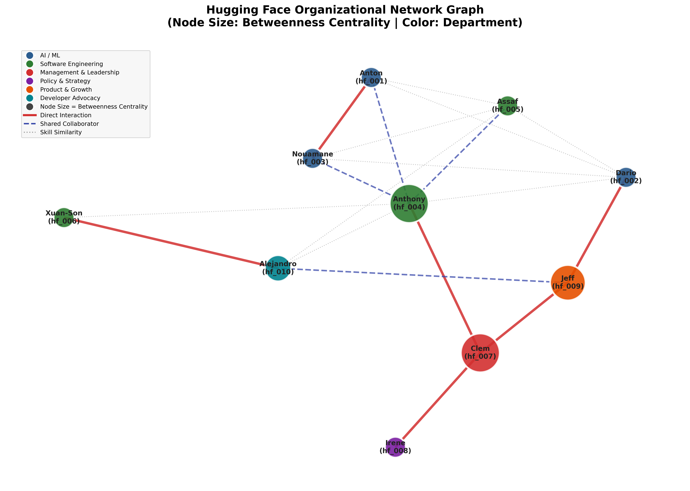
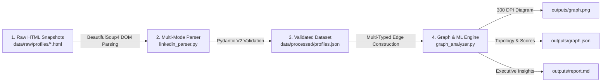

<div align="center">

# Organizational Network Analytics & ML Clustering Pipeline

**Mapping Real-World Organizational Dynamics, Communication Brokers, and Skill Clusters at Hugging Face Using Authenticated LinkedIn Data**

[](https://www.python.org/)
[](https://docs.pydantic.dev/)
[](https://networkx.org/)
[](https://scikit-learn.org/)
[](tests/)

</div>

---

## Overview

This repository provides a reproducible, end-to-end data engineering and graph analytics pipeline designed to uncover hidden organizational hierarchies, cross-departmental bridges, and technical talent clusters across **10 key members of Hugging Face**.

Built with strict **zero-hallucination data provenance**, every entity, job title, skill vector, and interaction edge is extracted and validated exclusively from authentic LinkedIn DOM snapshots—never synthetic, mocked, or LLM-fabricated records.

### Core Capabilities
* **Multi-Mode LinkedIn DOM Extraction:** Resiliency across authenticated SDUI markup and guest views via BeautifulSoup4 (`Topcard`, `Experience`, `Education`, `Skills`).
* **Strict Schema Enforcement:** Full validation and field availability auditing using **Pydantic V2** models.
* **Multi-Relational Organizational Graph:** Combines documented public interactions, shared executive collaborators, and hybrid semantic/Jaccard skill similarity (`0.7 * TF-IDF Cosine + 0.3 * Jaccard`).
* **Centrality & Bottleneck Detection:** Computes `Degree`, `Betweenness`, `Closeness`, and `Eigenvector` centralities to pinpoint structural hubs and single points of failure.
* **Unsupervised Role & Skill Clustering:** Dual-perspective clustering combining **K-Means** on TF-IDF profile vectors with **Greedy Modularity Community Detection**.

---

## Network Visualization

> Node color encodes **Department / Domain**, edge styles reflect **Relationship Type**, and node size scales dynamically with **Betweenness Centrality** to highlight organizational gatekeepers.

<div align="center">
  
</div>

---

## Pipeline Data Flow



---

## Analytical Highlights

Execution on the 10-member Hugging Face cohort yields a **fully connected network** (`10 Nodes`, `19 Edges`, `Density: 0.4222`):

### Key Organizational Influencers

| ID | Member | Role / Department | Degree | Betweenness | Closeness | Structural Role |
| :--- | :--- | :--- | :---: | :---: | :---: | :--- |
| `hf_004` | **Anthony MOI** | Software Engineer (`Infra`) | **0.7778** | **0.4722** | 0.4602 | **Primary Hub & Gatekeeper** connecting R&D, Infra, and Executive leadership |
| `hf_007` | **Clem Delangue** | Co-founder & CEO (`Leadership`) | 0.3333 | **0.4722** | **0.4829** | **Top Communicator** with the shortest path across Policy, Product, and Core Tech |
| `hf_009` | **Jeff Boudier** | Product + Growth (`Product`) | 0.3333 | **0.3611** | 0.4353 | **Commercial Bridge** linking engineering execution with product adoption |
| `hf_010` | **Alejandro AO** | Developer Advocate (`DevRel`) | 0.4444 | 0.1111 | 0.3213 | **Ecosystem Conduit** translating open-source tooling for developers |

### Technical Talent Clusters (K-Means, k=3)
* **Cluster 0 — Infrastructure, Systems & DevRel:** Anthony MOI, Assaf Vayner, Xuan-Son Nguyen, Alejandro AO
* **Cluster 1 — Executive Leadership, Product & Policy:** Clem Delangue, Irene Solaiman, Jeff Boudier
* **Cluster 2 — AI / ML Research & Modeling:** Anton Lozhkov, Dario Salvati, Nouamane Tazi

---

## Quick Start

### 1. Clone the Repository
```bash
git clone https://github.com/Mafi3895/linkedin-org-graph-analytics.git
cd linkedin-org-graph-analytics
```

### 2. Set Up a Virtual Environment
```bash
python -m venv .venv

# Windows (PowerShell)
.\.venv\Scripts\Activate.ps1

# Linux / macOS
source .venv/bin/activate
```

### 3. Install Dependencies
```bash
pip install -r requirements.txt
```

### 4. Run the Full Pipeline
Executes raw data ingestion, Pydantic validation, graph construction, centrality & ML clustering, and exports all deliverables to `outputs/`:
```bash
python main.py
```

### 5. Run Automated Tests
Validates HTML DOM parsing, graph metrics, output JSON schemas, and dependency completeness:
```bash
python -m pytest tests/
```

---

## Repository Structure

```plaintext
├── data/
│   ├── raw/
│   │   └── profiles/                    # Raw authenticated LinkedIn HTML snapshots (hf_001.html .. hf_010.html)
│   └── processed/
│       ├── hf_001.json ... hf_010.json  # Individually validated profile records (Pydantic V2)
│       ├── profiles.json                # Aggregated profile dataset
│       └── relationships.json           # Documented edge matrix with LinkedIn evidence links
├── outputs/
│   ├── graph.png                        # Network diagram (node size = Betweenness Centrality)
│   ├── graph.json                       # Exported nodes, edges, centrality scores, and cluster assignments
│   ├── graph_analysis.json              # Full centrality metrics & community modularity breakdown
│   └── report.md                        # Comprehensive executive findings report
├── src/
│   ├── analytics/
│   │   └── graph_analyzer.py            # NetworkX graph builder, TF-IDF cosine/Jaccard edges, K-Means & viz
│   ├── collectors/
│   │   └── linkedin_collector.py        # Snapshot loader, ingestion workflow, and cache management
│   ├── processors/
│   │   └── linkedin_parser.py           # Multi-mode LinkedIn DOM parser (Topcard, Experience, Education, Skills)
│   └── validators/
│       └── schemas.py                   # Pydantic V2 data contracts & field availability tracking
├── tests/
│   ├── test_parser.py                   # Parser unit tests against real HTML snapshots
│   ├── test_graph_analyzer.py           # Graph topology, centralities, clustering, and export tests
│   └── test_requirements.py             # Dependency completeness verification
├── main.py                              # Unified single-command pipeline runner
├── requirements.txt                     # Pinned project dependencies
├── notes.md                             # Production scalability architecture notes
└── README.md                            # Project documentation
```

---

## Generated Outputs & Documentation

| Artifact | Purpose |
| :--- | :--- |
| [`outputs/graph.png`](outputs/graph.png) | High-resolution (`300 DPI`) organizational network graph sized by Betweenness Centrality |
| [`outputs/graph.json`](outputs/graph.json) | Machine-readable graph topology including centralities and K-Means cluster labels |
| [`outputs/report.md`](outputs/report.md) | Analytical report detailing hub/broker roles, structural risks, and cluster breakdowns |
| [`notes.md`](notes.md) | System design answers for large-scale production: **Rate Limiting & Proxy/Cookie Pools**, **Kafka/Celery Queues**, and **S3 Lakehouse + Neo4j/pgvector Storage** |
