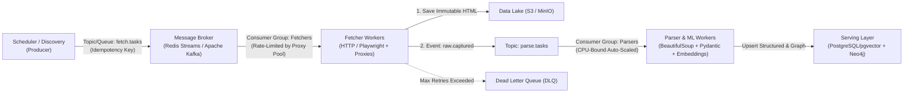

# یادداشت‌های فنی، فرضیات طراحی و معماری مقیاس‌پذیری

این سند شامل **فرضیات طراحی و متدولوژی جمع‌آوری داده در این پروژه** (بخش ۰) و همچنین پاسخ‌های معماری جهت انتقال پایپلاین فعلی به یک سامانه عملیاتی در مقیاس میلیونی (بخش‌های ۱ تا ۳) است.

---

## ۰. فرضیات پروژه و استراتژی عبور از محدودیت‌های لینکدین (Data Acquisition Strategy)

### چالش دسترسی عمومی (Guest View vs. Authenticated View)
در بررسی اولیه مشخص شد که وب‌سایت لینکدین در حالت بدون لاگین (Unauthenticated HTTP / Guest View) محدودیت‌های سخت‌گیرانه‌ای (**Authwall** و خطای `HTTP 999`) اعمال می‌کند:
1. بخش‌های **Skills** (مهارت‌ها) و **Interests** (علایق) به‌طور کامل در نمای مهمان مخفی هستند.
2. عناوین شغلی فعلی و سوابق کاری پیشین (**Work Experience**) در کدهای HTML عمومی با کاراکترهای ستاره (`*******`) یا عبارات محدودشده ماسک می‌شوند.
3. جزئیات رشته، مقطع و کارت‌های تحصیلی (**Education**) در متادیتای عمومی (`Schema.org / JSON-LD`) به‌صورت کامل قرار نمی‌گیرند.

### راهکار اجرایی در این نمونه (Hybrid Snapshot Ingestion برای ۱۰ پروفایل Hugging Face)
از آنجا که هدف پروژه، پوشش واقعی بخش‌های پروفایل و اجرای الگوریتم‌های شباهت مهارت و خوشه‌بندی ML بدون تولید داده جعلی (Synthetic/Mock) و بدون به خطر انداختن امنیت اکانت شخصی یا نیاز داور به وارد کردن کوکی لینکدین بود، معماری **Hybrid Snapshot Ingestion** پیاده‌سازی شد:
* صفحات پروفایل این ۱۰ نفر در نشست معتبر مرورگر باز شده و اسنپ‌شات‌های کامل DOM در مسیر `data/raw/profiles/*.html` به‌عنوان منبع حقیقت (Single Source of Truth) ذخیره شدند.
* ماژول گردآوری (`src/collectors/linkedin_collector.py`) و پارسر چندحالته (`src/processors/linkedin_parser.py`) این اسنپ‌شات‌ها را تجزیه کرده و هر ۶ بخش (`basic_info`, `work_experience`, `education`, `skills`, `interests`, `activity`) را استخراج و با مدل‌های **Pydantic V2** اعتبارسنجی می‌کنند (در عین حال متد کمکی `decode_snowflake_time` در پارسر برای استخراج تایم‌استمپ دقیق UTC از روی شناسه‌های 64-bit Snowflake URN لینکدین نیز پیاده‌سازی شده است).
* این رویکرد تضمین می‌کند که پایپلاین در محیط تست داور به‌صورت ۱۰۰٪ تکرارپذیر (**Reproducible**)، بدون نیاز به لاگین یا پروکسی و بدون ریسک مسدودیت اجرا شود.

### انتقال از اسنپ‌شات به استخراج خودکار در مقیاس بالا (1,000+ الی 1,000,000 پروفایل)
بدیهی است که ذخیره‌سازی دستی اسنپ‌شات برای ۱۰ نفر عملی است، اما برای هزاران پروفایل غیرقابل‌استفاده است. در مقیاس عملیاتی، استخراج خودکار بخش‌های محافظت‌شده از طریق ترکیب ۳ لایه زیر انجام می‌شود:

1. **شکار ترافیک شبکه در مرورگر بی‌سر (Playwright Network Interception):**
   * به جای پارس کردن شکننده کلاس‌های مبهم‌شده HTML یا ارسال درخواست خام `requests` (که به دلیل عدم تطابق اثر انگشت TLS/JA3 اکانت را مسدود می‌کند)، کلاسترهای مرورگر **Playwright** صفحه را باز می‌کنند.
   * با استفاده از شنودگر شبکه (`page.on("response")`)، پاسخ‌های JSON داخلی لینکدین (**Voyager API** مانند اندپوینت‌های `FullProfileWithEntities` و `profileUpdatesV2`) در حین پرواز (*In-flight*) شکار و ذخیره می‌شوند. به این ترتیب هم درخواست از طرف مرورگر واقعی ارسال شده و هم تمیزترین JSON ساختاریافته دریافت می‌گردد.

2. **استخر اشتراکی نشست‌ها (Shared Session & Account Pool):**
   * در مقیاس ۱۰۰۰ نفر به بالا، تکیه بر یک اکانت باعث مسدودیت فوری می‌شود. سیستم از یک **Session Pool** متمرکز در Redis استفاده می‌کند که شامل ده‌ها تا صدها نشست احراز هویت‌شده (`li_at` cookies) است.
   * هر نشست دارای سهمیه روزانه محدود (مثلاً ۵۰ پروفایل در روز با فاصله زمانی تصادفی)، آی‌پی مسکونی اختصاصی (**Sticky Residential IP**) و چرخه استراحت (**Cooldown**) است تا بار کلی بین کل استخر سرشکن شود.

3. **استفاده از لایه‌های داده B2B در مقیاس میلیونی (Licensed Data Providers & Enrichment APIs):**
   * در معماری‌های سازمانی بسیار بزرگ، برای کاهش هزینه نگهداری زیرساخت ضدبات و رعایت ملاحظات حقوقی، لایه اول داده‌ها از طریق APIهای تجمیع‌کننده داده سازمانی (مانند **Proxycurl**، **People Data Labs** یا **Bright Data Datasets**) تأمین شده و اسکرپرهای داخلی (`Session Pool`) صرفاً برای به‌روزرسانی لحظه‌ای (*Real-time Activity Fetching*) گره‌های کلیدی گراف به کار گرفته می‌شوند.

---

## ۱. مدیریت آنلاین HTTP، هدرها، User-Agent و Rate Limiting

در مقیاس واقعی، سامانه ضدربات پلتفرم‌هایی نظیر لینکدین نه تنها به نرخ درخواست (Rate Limit)، بلکه به همبستگی بین لایه‌های شبکه، TLS و رفتار مرورگر حساس است. راهکار جامع برای پایداری آنلاین بر سه رکن استوار است:

### الف) مکانیزم Exponential Backoff + Full Jitter و Circuit Breaker
* **مدیریت خطاهای موقت (`HTTP 429` و `5xx`):** به جای تلاش مجدد در بازه‌های ثابت (که باعث هم‌زمانی و ایجاد موج ترافیکی یا *Thundering Herd* می‌شود)، از الگوریتم Exponential Backoff با Jitter تصادفی استفاده می‌کنیم:
  $$\text{sleep\_time} = \min(\text{max\_cap}, \text{base\_delay} \times 2^{\text{attempt}}) \times \text{random}(0.5, 1.0)$$
* **کنترل نرخ توزیع‌شده (Distributed Rate Limiting):** پیاده‌سازی الگوریتم **Token Bucket / Sliding Window** بر بستر **Redis** به‌طوری‌که سقف مجاز درخواست (مثلاً حداکثر ۲۰ درخواست در دقیقه به ازای هر IP و سقف روزانه مجاز به ازای هر نشست) به صورت سراسری بین تمام ورکرها رعایت شود.
* **مدارشکن (Circuit Breaker):** در صورت دریافت کد خطای **`HTTP 999`** (محدودیت خاص لینکدین)، ریدایرکت به صفحه `checkpoint/challenge` یا افزایش خطاهای `403`، مدار برای آن Session/Proxy فوراً به حالت **Open** تغییر وضعیت داده و ورکر ترافیک را برای دوره خنک‌سازی (Cooldown مثلاً ۴ تا ۲۴ ساعت) متوقف یا به مسیر جایگزین هدایت می‌کند.

### ب) چرخش هوشمند پروکسی‌های خانگی (Residential & ISP Proxy Rotation)
* **پرهیز از IPهای دیتاسنتری:** آی‌پی‌های سرویس‌دهنده‌های ابری (AWS، GCP، Azure، Hetzner) در لایه **ASN** بلافاصله توسط فایروال‌های Edge (Cloudflare/Akamai) پرچم‌گذاری و مسدود می‌شوند. در محیط عملیاتی از **ISP / Residential Proxies** (آی‌پی‌های کاربران واقعی اینترنت خانگی یا اپراتور موبایل 4G/5G) استفاده می‌شود.
* **الگوی Sticky Session (Session-to-IP Pinning):** برخلاف چرخش کورکورانه در هر درخواست، هر اکانت یا کوکی معتبر به یک آی‌پی خانگی ثابت در همان منطقه جغرافیایی مشخص متصل می‌شود تا خطای امنیتی «پرش جغرافیایی غیرعادی» (*Impossible Travel*) فعال نشود.
* **سنجش سلامت IP:** امتیازدهی لحظه‌ای به هر پروکسی بر اساس نرخ موفقیت (Success Rate) و تأخیر (Latency) و حذف خودکار نودهای سوخته از استخر.

### ج) استخر نشست‌ها (Session / Cookie Pool) و هم‌خوانی اثر انگشت TLS/HTTP
* **مدیریت متمرکز نشست‌ها در Redis Hash:** نگهداری کوکی‌های احراز هویت (نظیر `li_at` و `JSESSIONID`) همراه با متادیتای زمان ایجاد، سهمیه باقی‌مانده روزانه و وضعیت سلامت. نشست‌های جدید پیش از ورود به بار اصلی، دوره **Warm-up** (رفتارهای عادی با نرخ پایین) را طی می‌کنند.
* **هم‌خوانی لایه HTTP و TLS (JA3/JA4 Fingerprint Consistency):** جعل صرف هدر `User-Agent` کافی نیست؛ اگر `User-Agent` مربوط به Chrome 128 باشد اما اثر انگشت TLS پایتون (`requests` یا `urllib3`) ارسال شود، درخواست درجا رد می‌شود. بنابراین، برای درخواست‌های مستقیم از کتابخانه‌هایی با شبیه‌سازی کامل مرورگر در لایه TLS/HTTP2 (همچون `curl_cffi`) و برای صفحات نیازمند رندر جاوااسکریپت از کلاسترهای **Playwright / Chromium** ایزوله با تزریق هدرهای هم‌خوان (`sec-ch-ua`، `Accept-Language`، `Referer`) و تأخیرهای تصادفی شبه-انسانی استفاده می‌شود.

---

## ۲. پردازش توزیع‌شده با صف پیام (Queue-Based Architecture: Redis / Kafka)

برای پردازش ده‌ها هزار تا میلیون‌ها پروفایل و تفکیک بخش‌های I/O-Bound (شبکه) از CPU-Bound (تجزیه DOM و یادگیری ماشین)، معماری **Producer-Consumer** پیاده‌سازی می‌شود:

### جزئیات کلیدی معماری صف:
1. **تقسیم وظایف با Celery + Redis یا Apache Kafka:**
   * **سناریوی Task-Oriented (Celery + Redis):** برای صف‌بندی کارهای زمان‌بندی‌شده، Retry با تأخیر دقیق (`retry_countdown`) و مدیریت اولویت (`High Priority` برای مدیران و مهره‌های کلیدی؛ `Low Priority` برای به‌روزرسانی‌های دوره‌ای) ایده‌آل است. با فعال‌سازی `acks_late=True`، در صورت کرش کردن ورکر، تسک از دست نمی‌رود و به ورکر دیگری سپرده می‌شود.
   * **سناریوی Stream-Oriented (Apache Kafka):** هنگام ورود جریان پیوسته داده‌ها، پارتیشن‌بندی بر اساس کلید `person_id` ترتیب زمانی تغییرات هر پروفایل را تضمین کرده و امکان **Event Replay** (پردازش مجدد پیام‌های گذشته پس از ارتقای الگوریتم پارسر) را فراهم می‌سازد.
2. **جلوگیری از تکرار (Idempotency):**
   * تولید کلید یکتا از ترکیب شناسه فرد و بازه زمانی (مانند `sha256(person_id + YYYY-MM)`) در Redis (یا Deduplication Window) باعث می‌شود در صورت دریافت لینک تکراری یک فرد از مسیرهای مختلف گراف، استخراج تکراری انجام نشود.
3. **کنترل فشار معکوس (Backpressure) و صف خطا (Dead Letter Queue - DLQ):**
   * اگر نرخ خطای استخر پروکسی افزایش یابد یا صف پردازش پر شود، مکانیزم Backpressure سرعت تولید پیام‌های جدید توسط Scheduler را کاهش می‌دهد.
   * پیام‌هایی که پس از N بار تلاش با خطای تغییر ساختار DOM (*Schema Drift*) یا خطای دائمی (`404`) مواجه می‌شوند، به صف **DLQ** ارسال شده تا تیم مهندسی داده بدون متوقف شدن خط لوله اصلی، دلیل خرابی را بررسی و پارسر را به‌روزرسانی کند.

---

## ۳. استراتژی ذخیره‌سازی در مقیاس بزرگ (Large-Scale Storage & Lakehouse)

ذخیره‌سازی فایل‌های JSON محلی در مقیاس بزرگ دچار افت شدید کارایی در جستجو، همزمانی (Concurrency) و تحلیل روابط چندمرحله‌ای می‌شود. راهکار استاندارد صنعتی، جداسازی کامل **لایه ذخیره خام (Data Lake)** از **لایه تحلیلی گراف و بردار (Serving Layer)** است:

### الف) لایه داده خام و تغییرناپذیر (Raw Data Lake — AWS S3 / MinIO)
* **ساختار ذخیره‌سازی:** ذخیره اسنپ‌شات‌های خام HTML و متادیتای زمان دریافت به صورت فشرده (Zstandard / Gzip) و **Immutable (Append-Only)** در پارتیشن‌های تاریخ‌دار و فرمت ستونی **Apache Parquet / Iceberg**:
  `s3://cyberian-datalake/raw/linkedin/year=2026/month=11/day=11/hf_001.html.zst`
* **مزایای کلیدی:**
  * **قابلیت ممیزی و اصالت‌سنجی (Data Lineage & Auditability):** امکان ردیابی هر رکورد تحلیلی تا اسنپ‌شات اصلی آن در زمان مشخص.
  * **پردازش مجدد بدون نیاز به شبکه (Schema-on-Read & Backfill):** اگر یک ماه بعد تصمیم بگیریم ویژگی جدیدی (مثلاً جوایز یا مقالات) را از پروفایل‌ها استخراج کنیم، اسکریپت پارسر مستقیماً روی فایل‌های بایگانی شده در S3 اجرا می‌شود بدون آنکه کوچک‌ترین درخواستی به لینکدین ارسال شود.

### ب) لایه تحلیلی گراف (Graph Database — Neo4j / Amazon Neptune)
* **ساختار مدل گراف:** تبدیل داده‌های پردازش‌شده به موجودیت‌های استاندارد گراف:
  * **گره‌ها (Nodes):** `:Person`, `:Company`, `:Skill`, `:Institution`
  * **یال‌ها (Relationships):** `:WORKED_AT`, `:INTERACTED_WITH`, `:REPOSTED_FROM`, `:SIMILAR_SKILL` (با ویژگی وزن `weight` و زمان `timestamp`).
* **علت انتخاب دیتابیس گراف:** کوئری‌های تحلیلی مثل «پیدا کردن کوتاه‌ترین مسیر ارتباطی تا ۴ درجه»، «شناسایی پل‌های ارتباطی (Betweenness Centrality)» یا «تشخیص جوامع (Louvain Community Detection)» در دیتابیس‌های رابطه‌ای نیازمند `JOIN`های تودرتو (`Recursive CTE`) هستند که با رشد گراف به شدت کند می‌شوند؛ در حالی که موتورهای گراف با **Index-Free Adjacency** و پکیج‌هایی مانند **Neo4j Graph Data Science (GDS)** این محاسبات را در کسری از ثانیه روی میلیون‌ها گره اجرا می‌کنند.

### ج) لایه رابطه‌ای و جستجوی برداری (PostgreSQL + `pgvector`)
* **داده ساختاریافته و تاریخچه (Relational Store):** نگهداری پرونده نهایی اعتبارسنجی‌شده با Pydantic، وضعیت احراز هویت و جدول تاریخچه تغییرات شغلی (با الگوی *Slowly Changing Dimensions Type 2*).
* **جستجوی معنایی با `pgvector`:** به جای محاسبه $O(N^2)$ ماتریس شباهت کسینوسی در حافظه (RAM)، بردارهای Embedding مهارت‌ها، سوابق و توضیحات پروفایل در ستون‌های `VECTOR` در PostgreSQL ذخیره شده و با ایندکس **HNSW** برای یافتن شباهت‌های معنایی (Semantic Skill Similarity) و تشکیل یال‌های پیشنهادی در میلی‌ثانیه استفاده می‌شوند.

### د) همگام‌سازی لایه‌ها (Lakehouse Pipeline)
* جریان تغییر داده‌ها از لایه پاک‌سازی‌شده (**Silver Layer**) از طریق پایپلاین‌های **Apache Spark** یا **CDC (Debezium / Kafka Connect)** به‌صورت تراکنشی و همگام به هر دو مقصد **PostgreSQL/pgvector** (برای جستجوی متنی و برداری) و **Neo4j** (برای تحلیل‌های توپولوژی شبکه) تزریق می‌گردد.
